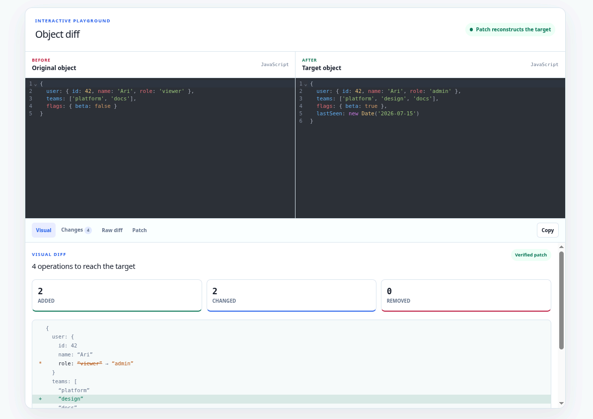

<div align="center">

# @opentf/obj-diff

An [Open Tech Foundation](https://opentechf.org/) project.

> ## The Fast, Accurate, and Modern JavaScript Objects Diffing & Patching Library.

### [Documentation & Playground](https://obj-diff.opentechf.org/)



</div>

---

## 🚀 Features

- 🔍 **Deep Objects Diffing**: Detects changes at any depth.
- ✂️ **Compact Array Diffs**: Shortest edit scripts (Myers LCS) — inserting one element into a 10k array yields 1 op, not 10,001.
- 🩹 **Efficient Patching**: Apply diffs to recreate target objects.
- 🧬 **Type-Safe Serialization**: Round-trip diffs across network/process boundaries with `serialize` and `deserialize` preserving all JS native types.
- 🛠️ **Extensible**: Support for custom object types via `diffWith()`.
- 📦 **Modern Ecosystem**: Built for Bun, Node.js, Deno, and Browser.
- 🟦 **TypeScript Native**: Full type safety and autocompletion.
- ⚡ **High Performance**: Optimized for speed and minimal memory footprint.

## 📦 Installation

Install `@opentf/obj-diff` using your preferred package manager:

```sh
# Bun
bun add @opentf/obj-diff

# pnpm
pnpm add @opentf/obj-diff

# npm
npm install @opentf/obj-diff

# yarn
yarn add @opentf/obj-diff

# Deno
deno add @opentf/obj-diff
```

## 🛠 Supported Types

The library natively supports the following types:

- **Primitives**: `Undefined`, `Null`, `Number`, `String`, `Boolean`, `BigInt`.
- **Built-in Objects**: `Plain Objects {}`, `Array`, `Date`, `Map`, `Set`, `TypedArray` (`Uint8Array`, `Float32Array`, etc.), `ArrayBuffer`, `DataView`.
- **Temporal**: all `Temporal` types (`Instant`, `PlainDate`, `PlainTime`, `PlainDateTime`, `PlainYearMonth`, `PlainMonthDay`, `ZonedDateTime`, `Duration`) — compared as immutable values (`Duration` structurally by its canonical string, since it has no `.equals()`).
- **Class Instances**: instances sharing the same prototype are diffed by their own enumerable properties; instances of different classes are reported as replaced.

## 📖 Usage

### `diff(obj1, obj2)`

Performs a deep comparison between two objects.

```ts
import { diff } from '@opentf/obj-diff';

const result = diff(obj1, obj2);
```

#### `DiffResult` Structure
```ts
type DiffResult = {
  type: 0 | 1 | 2 | 3 | 4; // 0: Deleted, 1: Added, 2: Changed,
                           // 3: Inserted (array splice-in), 4: Removed (array splice-out)
  path: Array<unknown>;    // path to the property; Map entries use the Map key itself
  value?: unknown;         // the new value (for types 1, 2 and 3)
};
```

Types `3` (`INSERTED`) and `4` (`REMOVED`) are array-only splice operations with application-time indexes — they are what make array diffs compact:

```js
diff([1, 2, 3], [0, 1, 2, 3]);
//=> [{ type: 3, path: [0], value: 0 }]  // 1 op, not 4
```

The constants (`DELETED`, `ADDED`, `CHANGED`, `INSERTED`, `REMOVED`) are exported from the package root.

### `patch(obj, patches)`

Applies an array of diff results to an object.

```ts
import { patch } from "@opentf/obj-diff";

const updatedObj = patch(originalObj, diffResults);
```

### Undo / redo

A diff is forward-only: it does not contain the old values needed to derive an inverse later. Store both directions while both states are available:

```ts
const change = {
  redo: diff(previous, next),
  undo: diff(next, previous),
};

state = patch(state, change.redo);
state = patch(state, change.undo);
```

### `serialize(diff)` / `deserialize(wire)`

A diff holds **live** values by reference, so `JSON.stringify` loses their types (`Date`→string, `Map`/`Set`→`{}`, `BigInt`→throws). Use `serialize`/`deserialize` to send a diff across a process or network boundary and patch it back into the **correct types** on the other side:

```ts
import { diff, patch, serialize, deserialize } from "@opentf/obj-diff";

// client
const wire = serialize(diff(a, b)); // a JSON string, type-safe

// server
const patched = patch(a, deserialize(wire)); // Date/Map/Set/… restored exactly
```

`value` stays readable — each special value becomes a reference token `"@n"`, with the real types collected in a per-op `$refs` table:

```json
{
  "type": 1,
  "path": ["user"],
  "value": { "id": 1, "lastSeen": "@1", "roles": "@2" },
  "$refs": {
    "1": { "_t": "Date", "_v": "2026-07-15T00:00:00.000Z" },
    "2": { "_t": "Set", "_v": ["admin", "editor"] }
  }
}
```

Every supported type is preserved (`Date`, `RegExp`, `Map`, `Set`, `TypedArray`, `ArrayBuffer`, `DataView`, `Error`, `URL`, `BigInt`, `Temporal`, …), nested to any depth. **Circular references** and objects **shared by identity** are rebuilt with the same identity on the far side — including cycles through a `Map`/`Set`/`Error`; single-use plain containers stay inline. Symbols, functions and class instances throw (a `SerializeError`). Deserializing a `Temporal` value requires a `Temporal` implementation on `globalThis`.

The codec itself is [`@opentf/serialize`](https://github.com/Open-Tech-Foundation/js-serialize): `serialize`/`deserialize` shape its low-level `encode`/`decode` into the per-op diff format above, and `stringify`/`parse` are re-exported unchanged.

### `stringify(value)` / `parse(wire)`

Need the same type-safe codec for **any** value, not just a diff? `stringify`/`parse` are the general-purpose counterpart — a drop-in, richer `JSON.stringify`/`JSON.parse` that keeps native types intact:

```ts
import { stringify, parse } from "@opentf/obj-diff";

const wire = stringify({
  when: new Date(),
  tags: new Set(["a", "b"]),
  prefs: new Map([["theme", "dark"]]),
  big: 42n,
});

const value = parse(wire); // Date / Set / Map / BigInt all restored
```

Same coverage as above — every native type, plus circular references and shared identity. Symbols, functions, and class instances throw.

---

## 💡 Examples

### 1. Basic Objects
```js
const a = { a: 1, b: 2 };
const b = { a: 2, c: 3 };

diff(a, b);
/*
[
  { type: 2, path: ["a"], value: 2 },
  { type: 0, path: ["b"] },
  { type: 1, path: ["c"], value: 3 }
]
*/
```

### 2. Nested Structures
```js
const a = { foo: { bar: [1, 2] } };
const b = { foo: { bar: [1] } };

const d = diff(a, b);
const res = patch(a, d); // res is deep equal to b
```

### 3. ES6 Map & Set Support
Natively diff and patch modern collections.

```js
const a = new Set([1, 2]);
const b = new Set([2, 3]);

diff(a, b);
/*
[
  { type: 2, path: [0], value: 2 },
  { type: 2, path: [1], value: 3 }
]
*/
```

### 4. Circular Reference Safety
Safe comparison of recursive objects without infinite loops.

```js
const a = { id: 1 };
a.self = a;
const b = { id: 2 };
b.self = b;

diff(a, b); 
// Output: [{ type: 2, path: ["id"], value: 2 }]
```

### 5. Custom Types via `diffWith()`
Extend the diffing logic for specialized types like MongoDB `ObjectId`.

```js
import { diffWith } from "@opentf/obj-diff";
import { ObjectId } from "bson";

const result = diffWith(record1, record2, (a, b) => {
  if (a instanceof ObjectId && b instanceof ObjectId) {
    return a.toString() !== b.toString();
  }
});
```

---

## ⚠️ Caveats

### Internal Object Sharing (Aliasing)

For maximum performance, `@opentf/obj-diff` preserves internal object identity (sharing) during the `patch()` operation. 

If your original object contains multiple paths pointing to the **same object instance**, patching one of those paths will affect all its aliases.

```js
const shared = { x: 1 };
const a = { first: shared, second: shared };
const b = { first: { x: 1 }, second: { x: 2 } };

const d = diff(a, b);
const res = patch(a, d);

// res.first.x will be 2 because it shares the same instance as res.second
console.log(res.first.x); // 2
```

> [!TIP]
> If you require independent branches after patching, ensure your input objects do not share internal references that are expected to diverge.

---

## 📊 Comprehensive Benchmarks

The benchmark suite lives in [`benchmarks/`](./benchmarks), built on [`mitata`](https://github.com/evanwashere/mitata). Its output is rendered live on the site — the [Benchmarks](https://obj-diff.opentechf.org/docs/benchmarks) page for diff size and speed, and the [Comparison](https://obj-diff.opentechf.org/docs/comparison) page for the native-type accuracy matrix. Every number there is generated by `tsr benchmarks:collect` and rendered straight from its JSON output — nothing is typed by hand, so the tables cannot drift from the code.

### Diff size (deterministic)

Op counts don't depend on the machine. This is where compact array diffs pay off — one operation per actual edit, not one per shifted element:

| Edit on a 10,000-element array | `@opentf/obj-diff` | `microdiff` |
| :--- | :---: | :---: |
| **Insert 1 element at the front** | **1** | 10,001 |
| **Insert 1 element in the middle** | **1** | 5,001 |
| **Remove 1 element from the middle** | **1** | 5,000 |
| **Remove a run of 10 elements** | **10** | 5,000 |

### Correctness across native types

The accuracy matrix answers the most important question — whether a library **notices** a change at all. `@opentf/obj-diff` is the only library in the matrix that catches changes inside both `Map` and `Set`; most JSON-oriented differs silently report `[]`. See the full matrix on the [Comparison](https://obj-diff.opentechf.org/docs/comparison) page.

### Speed

See the live [Benchmarks](https://obj-diff.opentechf.org/docs/benchmarks) page: diff speed across eight libraries, diff + patch round-trips, and honest notes on the cases where a positional differ wins. In short — within a whisker of the fastest differ on small objects, roughly 66× faster than `microdiff` on `TypedArray`s (a native compare instead of an element-wise walk), and orders of magnitude ahead of heavyweight libraries like `jsondiffpatch` on large arrays.

### Running Benchmarks Locally
```sh
tsr benchmarks:collect        # diff, patch, and native-type accuracy tables
```

---

## ❓ FAQs

### 1. Why is JSON Patch (RFC 6902) not supported?
The JSON Patch protocol is quite heavy and complex. We've optimized `@opentf/obj-diff` for performance and simplicity, which covers the vast majority of real-world use cases.

### 2. What does an empty path `path: []` mean?
An empty path denotes the **Root** of the object. It typically means the entire source was replaced by the target value (e.g., comparing an object to `null`).

---

## 📄 License

This project is licensed under the [MIT License](./LICENSE).

---
